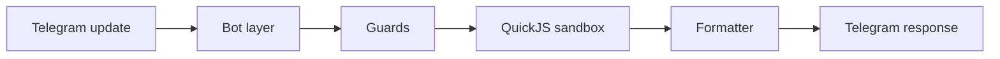
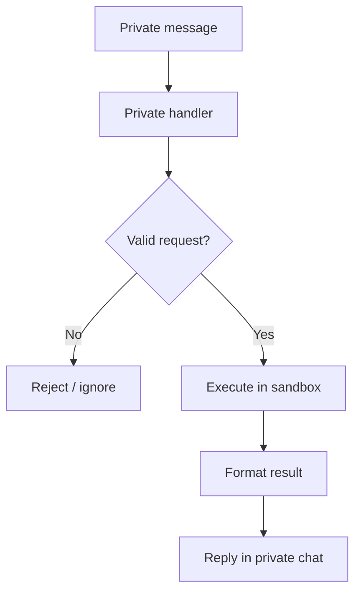
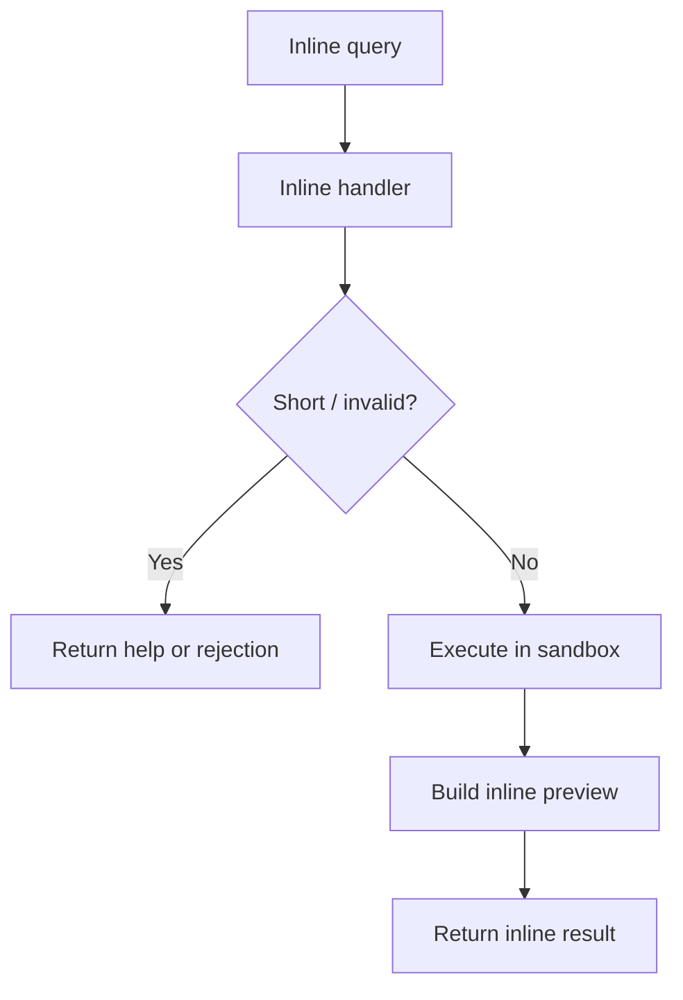
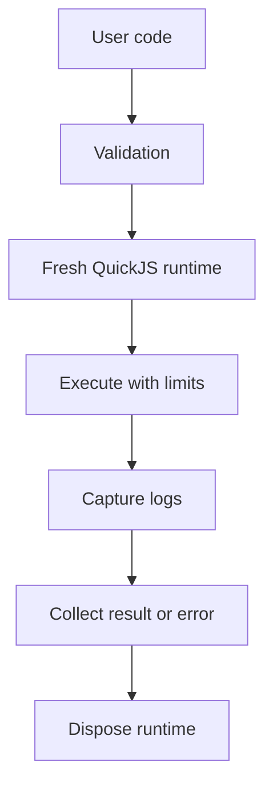

# Architecture

`@jsitbot` is a small Telegram bot with one core responsibility: receive JavaScript, run it inside an isolated sandbox, and send the output back in a Telegram-friendly format.

## Overview

## Main Parts

- Bot layer: receives Telegram updates and routes them to the right handler
- Guard layer: applies basic validation and rate limiting
- Sandbox layer: runs untrusted JavaScript in isolation
- Formatting layer: converts output into Telegram-safe text

## Private Message Flow

Notes:

- normal private text is treated as code
- bot-generated inline results received in private chat are handled separately

## Inline Query Flow

Notes:

- inline mode uses the same sandbox as private messages
- preview is short, final inserted message contains the formatted output

## Sandbox Flow

## Execution Surfaces

- Private messages
- Inline queries

Both surfaces share the same execution model and the same output contract.

## Security Model

- Each execution is isolated
- CPU and memory usage are limited
- Host APIs are not exposed inside guest code
- `console.log` output is captured and returned

## Design Goal

Keep the bot small, predictable, and easy to maintain.
