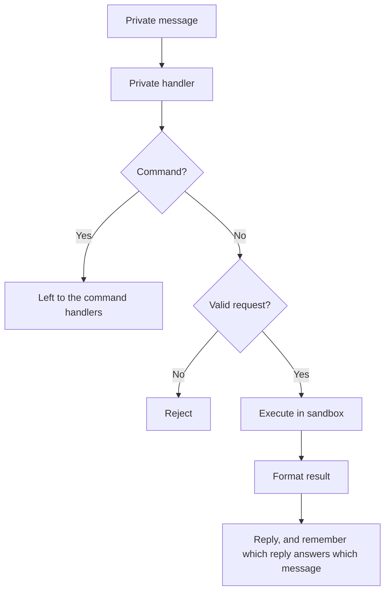
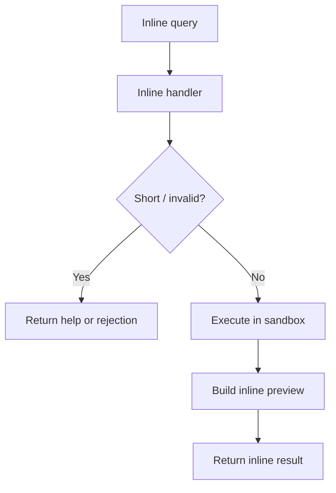
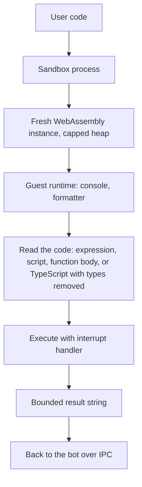

# Architecture

`@jsitbot` is a small Telegram bot with one core responsibility: receive JavaScript, run it inside an isolated sandbox, and send the output back in a Telegram-friendly format.

## Overview

## Main Parts

- Bot layer: receives Telegram updates and routes them to the right handler
- Guard layer: applies basic validation and rate limiting
- Sandbox layer: runs untrusted JavaScript in isolation, in a separate process
- Formatting layer: converts output into Telegram-safe text

## Private Message Flow

Notes:

- normal private text is treated as code; only `/word`, `/word@bot` followed by a space or the end of the message is a command, so a snippet that starts with a regular expression or a comment still runs
- bot-generated inline results received in private chat are handled separately
- an edited message is run again and the earlier answer is edited in place; the table that maps messages to answers is in memory and bounded, so after a restart an edit is answered as a new message

## Inline Query Flow

Notes:

- inline mode uses the same sandbox as private messages
- preview is short, final inserted message contains the formatted output
- results are not cached: code can read the clock or call `Math.random()`, and a run costs about a millisecond

## Sandbox Flow

- The child process holds the QuickJS engine and one spare runtime: a WebAssembly instance with a QuickJS runtime and context in it that already carry the guest runtime, built while the process is idle. Every run takes the spare, evaluates the user's code in it and drops it afterwards without tearing it down; the next spare is built once the reply is on its way. Nothing runs in a spare before the run that takes it. It is started with a minimal environment and without Bun's automatic `.env` loading, so it never sees the bot token, and it exits when the bot goes away.
- A dropped instance is freed when the garbage collector gets to it, and the collector counts every instance as 16 MB however much of it was used. After a run that filled more than a few megabytes the child collects at once, so a series of heavy runs does not pile up hundreds of megabytes of dead instances.
- The instance's memory has a hard maximum. QuickJS's own memory limit counts allocations rather than bytes in the Emscripten build, so it is not what stops a memory bomb.
- The guest runtime (`guest.js`) is evaluated when the spare is built, before any user code. It captures the built-ins it relies on, installs `console`, and turns results, errors and log lines into short strings, so nothing the guest controls is walked by the host.
- Text crosses the boundary as a C string, so the guest runtime makes it safe first: a NUL or another control character (except tab and line breaks) is written as `\xNN`, and a lone surrogate becomes U+FFFD. Without that, `"a\0b"` came back as `a`.
- The code is tried as one expression, then as a script (the last statement's value is the result), then as a function body (`return`, top-level `await`). If none parses, the types are stripped with Bun's transpiler and the same readings are tried again. The transpiler runs outside the guest, so its macros are switched off: a macro import would otherwise execute there while the types are being removed.
- `setTimeout` and `clearTimeout` live in the guest runtime. Once the promise queue is empty the host asks the guest to fire the earliest timer, repeating until none is left, so a sleep costs no real time and a run never holds the sandbox while it waits. A timer that keeps rescheduling itself runs into the time limit like any other loop.
- The child tells the bot when the guest's clock starts, and the bot waits for the timeout plus 150 ms from then (400 ms from the moment the run was sent if the child never says). If the child is still busy after that, it is killed and replaced (a replacement is ready in about 100 ms), and the run is reported as timed out. A process is killed outright; a worker thread kept running a stuck native call, and its memory, for seconds after being terminated.
- If a process cannot be started in the environment, the bot logs it and runs QuickJS inside itself, which keeps the interrupt handler and the memory cap but not the hard kill.

## Security Model

- Each execution is isolated: its own WebAssembly instance, runtime and context
- CPU time is limited by the engine's interrupt handler and, as a backstop, by killing the process; memory is limited by the instance's maximum size
- Host APIs are not exposed inside guest code
- Output size is bounded inside the sandbox
- Per-user rate limits apply to private messages, edits and inline queries; a run that times out is charged extra
