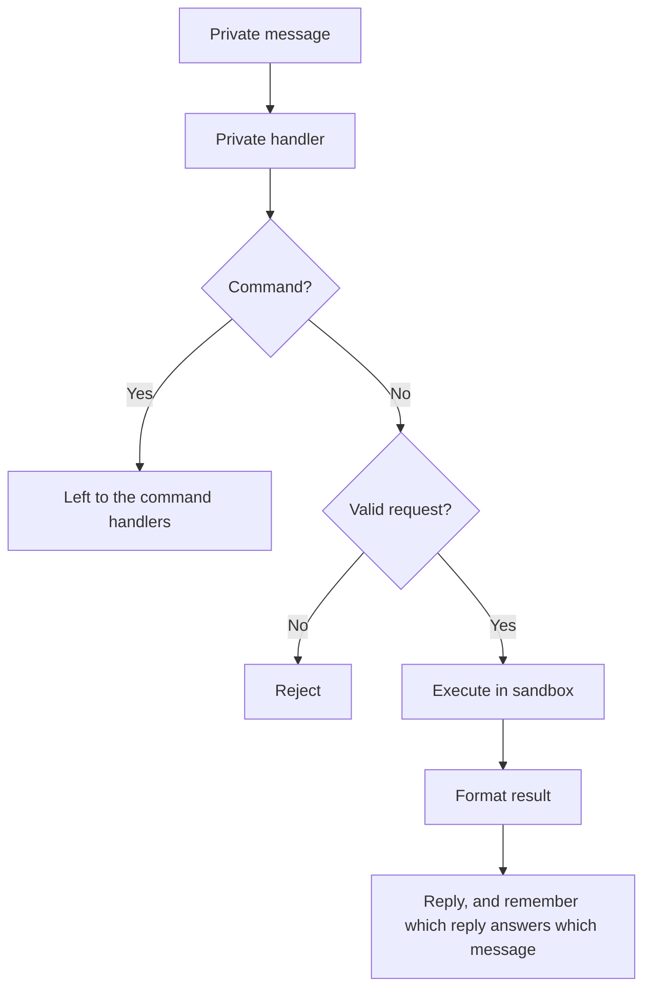
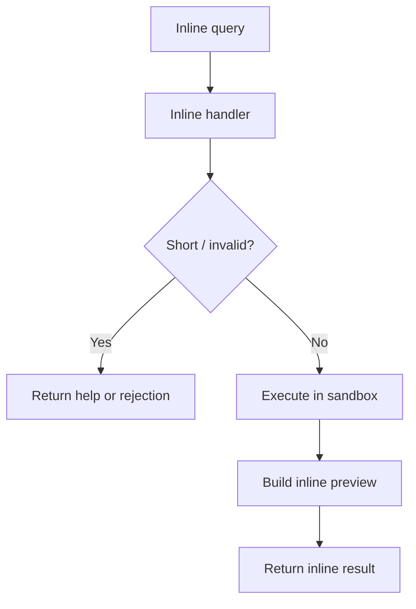
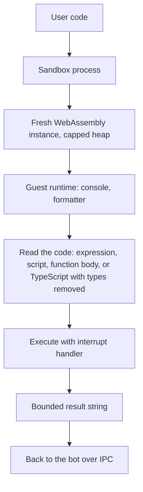

# Architecture

`@jsitbot` is a small Telegram bot with one core responsibility: receive JavaScript, run it inside an isolated sandbox, and send the output back in a Telegram-friendly format.

## Overview

## Main Parts

- Bot layer: receives Telegram updates and routes them to the right handler
- Guard layer: applies basic validation and rate limiting
- Sandbox layer: runs untrusted JavaScript in isolation, in a separate process
- Formatting layer: converts output into Telegram-safe text

## Private Message Flow

Notes:

- updates are handled several at a time (`src/bot/concurrency.ts`): grammY would otherwise wait for each reply to reach Telegram before it looked at the next update, and the sandbox, which takes a few milliseconds per run, sat idle for most of that. Up to 8 updates are in progress at once. Updates from one user still run one after the other, in order, so an edit is handled after the run it edits; a user who already has 3 in progress or waiting has the rest dropped, since that is a flood, except an edit of a message that already has an edit waiting, which replaces it: of several quick edits of one message only the newest is run, so the answer is the last text
- normal private text is treated as code; only `/word`, `/word@bot` followed by a space or the end of the message is a command, so a snippet that starts with a regular expression or a comment still runs
- bot-generated inline results received in private chat are handled separately
- output that does not fit in one message (the three sections share about 4000 characters) is cut in the message and sent whole as `output.txt` right after it; an edit removes the old file and sends a new one if the new answer is also cut, and a failure to send the file is only logged
- an edited message is run again and the earlier answer is edited in place; the table that maps messages to answers is in memory and bounded, so after a restart an edit is answered as a new message
- calls to Telegram pass through one layer (`src/runtime/telegramApi.ts`). It sends at most 25 messages, edits and reactions a second, which is under what Telegram allows, so a burst is answered more slowly instead of having most of its answers refused. When Telegram answers 429 with a time to wait, sends to that chat wait that long and the refused call is made again (up to 3 tries, for waits of up to 5 s); other chats are not held back, since the limit that answers with 429 is mostly the per-chat one. A long poll that has not been answered 10 s after its own 30 s timeout is abandoned and started again, so a connection that died without closing costs the bot 40 s, not grammY's default 500 s. Server errors and lost connections are retried only for calls that are safe to repeat, such as editing a message or answering an inline query; a message is never sent a second time on the chance that the first try went through

## Group Flow

A group has many people in it and most of what they write is not code for the bot, so it only reacts to a message that is addressed to it: `/run code`, `@bot code`, or either of them as a reply, in which case the code is the first code block of the message that is replied to, or its whole text (`src/bot/handlers/runCommand.ts`). The same handler answers in private chats, where `/run` is otherwise ignored like any other command.

- the limits are the ones of private messages and the counters are shared (`src/bot/runner.ts`), so a user gets no more by mixing the two
- a user who is over the request limit or the sandbox time budget gets no answer in a group, since an answer there is one more message for everybody; a message over the length limit does get one
- an edit of the `/run` message is not run again
- in a private chat, a `/run` whose output does not fit gets the whole output as `output.txt` after the answer, as an ordinary message does; in a group it does not, since the file would be one more message for everybody

## Inline Query Flow

Notes:

- inline mode uses the same sandbox as private messages
- preview is short, final inserted message contains the formatted output
- results are not cached: code can read the clock or call `Math.random()`, and a run costs about a millisecond

## Sandbox Flow

- The child process holds the QuickJS engine and one spare runtime: a WebAssembly instance with a QuickJS runtime and context in it that already carry the guest runtime, built while the process is idle. Every run takes the spare, evaluates the user's code in it and drops it afterwards without tearing it down; the next spare is built once the reply is on its way. Nothing runs in a spare before the run that takes it. It is started with a minimal environment and without Bun's automatic `.env` loading, so it never sees the bot token, and it exits when the bot goes away.
- A dropped instance is freed when the garbage collector gets to it, and the collector counts every instance as 16 MB however much of it was used. After a run that filled more than a few megabytes the child collects at once, so a series of heavy runs does not pile up hundreds of megabytes of dead instances.
- The instance's memory has a hard maximum. QuickJS's own memory limit counts allocations rather than bytes in the Emscripten build, so it is not what stops a memory bomb.
- The guest runtime (`guest.js`) is evaluated when the spare is built, before any user code, with its comments and indentation removed first since QuickJS would only parse and discard them (a third less to parse). It captures the built-ins it relies on, installs `console`, and turns results, errors and log lines into short strings, so nothing the guest controls is walked by the host.
- Larger parts of the environment (`structuredClone`, the text encoders and base64, `URL`, `crypto`, and anything else that is not needed by every program) live in `src/services/sandbox/extras/` and are not evaluated with the guest runtime. The global is an accessor; the first time the program reads it, the runtime asks the host for that part's source by name and evaluates it, so a program that never uses it never pays for parsing it. The host answers with a string from this repository and nothing else, and the names are fixed in the guest runtime. `String.prototype.localeCompare` is such a part too, reached through a method that evaluates it on the first call. The only other thing the host gives the guest is 128 random bits per run, which `crypto` uses to start its generator; it is a plain generator in the guest, not a call to the host, so it is not suitable for secrets.
- Text crosses the boundary as a C string, so the guest runtime makes it safe first: a NUL or another control character (except tab and line breaks) is written as `\xNN`, and a lone surrogate becomes U+FFFD. Without that, `"a\0b"` came back as `a`.
- The code is tried as one expression, then as a script (the last statement's value is the result), then as a function body (`return`, top-level `await`), whose last statement is returned when it is an expression, as a script's is (`executionWrapper.ts` finds where it starts with the transpiler's REPL mode, and leaves the code where it is so line numbers hold). If none parses, the types are stripped with Bun's transpiler and the same readings are tried again. The transpilers run outside the guest, so their macros are switched off: a macro import would otherwise execute there while the types are being removed.
- `setTimeout`, `setInterval` and their `clear` functions live in the guest runtime, as do `queueMicrotask` and `performance.now()`, which adds the virtual time to the real time that has passed. Once the promise queue is empty the host asks the guest to fire the earliest timer, repeating until none is left, so a sleep costs no real time and a run never holds the sandbox while it waits. A timer that keeps rescheduling itself, and an interval that is never cleared, run into the time limit like any other loop.
- The child tells the bot when the guest's clock starts, and the bot waits for the timeout plus 150 ms from then (400 ms from the moment the run was sent if the child never says). If the child is still busy after that, it is killed and replaced (a replacement is ready in about 100 ms), and the run is reported as timed out. A process is killed outright; a worker thread kept running a stuck native call, and its memory, for seconds after being terminated.
- If a process cannot be started in the environment, the bot logs it and runs QuickJS inside itself, which keeps the interrupt handler and the memory cap but not the hard kill.

## Starting and Stopping

- On SIGTERM or SIGINT the bot stops polling, which also tells Telegram which updates it has taken, and then waits for the answers in progress. The rest of a batch Telegram handed over at the same time is not taken: those updates are left for the next start, since they are not confirmed, and answering them now would answer them twice. A message that was taken but not answered before the process exits is never sent again, so the wait is what keeps a restart from losing it.
- "Nothing left" means no update taken and not finished, including one waiting for its turn behind a run, and no call to Telegram in progress. A run shows nothing to Telegram until it is over, so the bot also waits for none to have started for the time limit plus 400 ms (the 150 ms the sandbox allows past it, the restart of its process after a kill, and some room). An idle bot exits about 1.2 s after the signal.
- After 8 s the bot exits with status 1 whatever is left, and a second signal exits at once. A signal while the bot is still starting exits immediately: nothing has been taken yet.
- Pending updates are not dropped on start. Telegram keeps what arrived while the bot was down for 24 hours, and a restart takes seconds, so those messages are answered; a user who sent code during a deploy gets the answer. The per-user and sandbox-time limits apply to them like to any others.

## Security Model

- Each execution is isolated: its own WebAssembly instance, runtime and context
- CPU time is limited by the engine's interrupt handler and, as a backstop, by killing the process; memory is limited by the instance's maximum size
- Host APIs are not exposed inside guest code
- Output size is bounded inside the sandbox
- Per-user rate limits apply to private messages, edits and inline queries; a run that times out is charged extra
- Each user also has a budget of sandbox time per window, counted in the milliseconds their runs took and shared by private messages and inline queries. The request limits count runs, and a run can cost a millisecond or the whole timeout; the budget is what stops one account from holding the sandbox for a large share of the time
